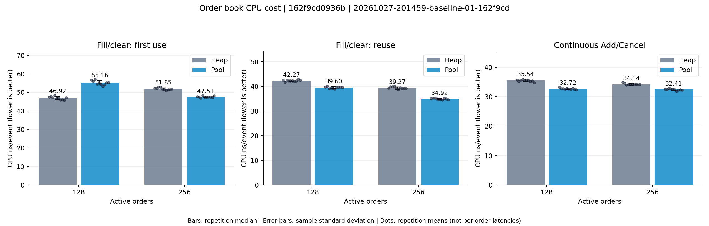
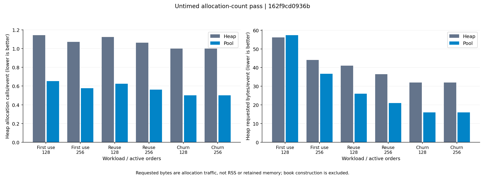

# Benchmark report — 20261027-201459-baseline-01-162f9cd

Commit: `162f9cd0936bfd0f1e3d9f52ba499852bbb4630e`

AMD Ryzen 3 5300U with Radeon Graphics; c++ (Ubuntu 11.4.0-1ubuntu1~22.04.3) 11.4.0; preset release; logical CPU 2; logging off

| Workload | Orders | Heap ns/event | Pool ns/event | Pool reduction | Heap CV | Pool CV |
|---|---:|---:|---:|---:|---:|---:|
| Fill/clear: first use | 128 | 46.92 | 55.16 | -17.6% | 1.8% | 2.2% |
| Fill/clear: first use | 256 | 51.85 | 47.51 | +8.4% | 1.2% | 0.9% |
| Fill/clear: reuse | 128 | 42.27 | 39.60 | +6.3% | 0.8% | 0.9% |
| Fill/clear: reuse | 256 | 39.27 | 34.92 | +11.1% | 1.2% | 0.8% |
| Continuous Add/Cancel | 128 | 35.54 | 32.72 | +8.0% | 1.0% | 0.8% |
| Continuous Add/Cancel | 256 | 34.14 | 32.41 | +5.1% | 0.9% | 0.8% |





- Each value is median CPU ns/event across repetition-level batch averages, not a per-order latency percentile.
- Fill/clear batches have 2N events; Add/Cancel churn batches have 8N events. Positive pool reduction means lower CPU cost.
- Book construction, seed/warm-up work, correctness checks and allocation counting are outside timing. Inactive allocation-probe overhead is included.
- Only core Add/Cancel is measured; Execute, registry dispatch, CSV parsing and logging are excluded.
- The frozen heap implementation and pooled implementation also differ in allocation-failure rollback logic.
- CPU scaling/background applications can affect results. Keep machine, affinity, compiler, library version and protocol identical when comparing runs.

Raw repetitions: `benchmark.json`, `repetitions.csv`. Machine/build/protocol: `metadata.json`. This baseline snapshot is committed here; subsequent local runs stay under the ignored results/ directory.

Open [report.html](report.html) locally for the full HTML view. GitHub renders the charts above and the raw data links directly.

Reproduce the measurement protocol from the repository root:

```bash
./tools/run_benchmarks.sh release results --cpu 2
```

The measured source is commit `162f9cd`; the reporting script was added afterward. Absolute paths in the original metadata, build files and command describe the original machine.
