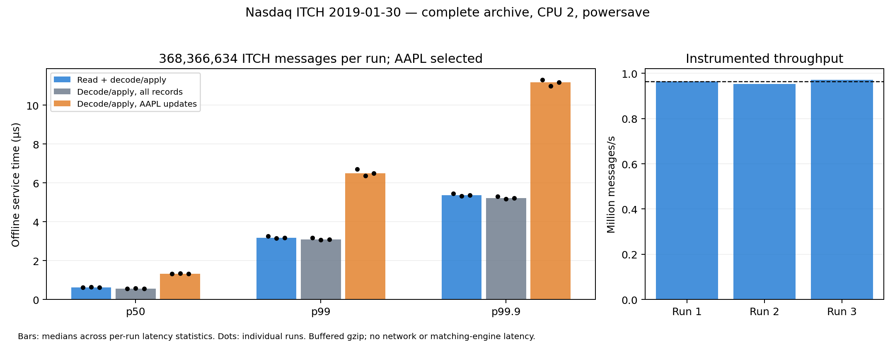

# Complete Nasdaq ITCH replay: 2019-01-30

The complete `01302019.NASDAQ_ITCH50.gz` archive contains **368,366,634 messages**
and produced **1,656,597 selected AAPL book updates per replay**.
Three complete measured replays processed 1,105,099,902 input-record observations.
All reached gzip EOF/CRC and exchange End of Messages, passed book invariants,
and produced identical final counts/FIFO snapshots. Final AAPL book is empty.

Input: **4,764,426,091 compressed bytes**; SHA-256
`8c97b5b13bc451c012c2466fb7e258da134dab29aa47b67fe7b0088c78e870be`. The archive itself is not committed.

AMD Ryzen 3 5300U; GCC 11.4.0 Release `-O3 -DNDEBUG`; one writer pinned to CPU 2;
governor **powersave**; diagnostic logging off for this replay;
8 MiB selected-book order-node pool. The file hash and a one-million-record prefix
warmup precede all measured replays. OS file caches are not flushed; CPU frequency
settings are not changed. This is a normal desktop run, not an isolated host.

## Median of the three per-run statistics

| Path | p50 (µs) | p99 (µs) | p99.9 (µs) |
|---|---:|---:|---:|
| read_decode_apply | 0.621 | 3.166 | 5.360 |
| decode_apply | 0.561 | 3.086 | 5.220 |
| selected_update_decode_apply | 1.333 | 6.493 | 11.161 |

Achieved instrumented throughput: **0.965 million messages/s**.
Consecutive-clock-pair median overhead: **20 ns**,
not subtracted. See [all per-run numbers](report.md) for means, maxima, durations
and each percentile. These are medians across run statistics, not pooled percentiles.

`read_decode_apply` starts before a record read and ends after decode, routing and
apply. Gzip/file access is buffered; refill/decompression work is charged to the
records triggering refills. `decode_apply` excludes reading but includes routing
for other symbols. `selected_update_decode_apply` restricts that same interval
to ITCH messages actually changing the selected AAPL displayed book. It includes
decoding/routing, not just the core `OrderBook::apply()` call.

These are **offline service times while replaying as fast as possible**. They do
not reproduce historical arrival rates, include queueing/network/journal/order-entry
matching, or subtract exchange timestamps from a local clock. Three clock reads
per record and histogram collection add overhead. Histogram recording is outside
each service-time interval but inside wall time/throughput. All source records
are timed, including the first and final exchange messages; no sampling is used.

Exact frequency counts retain nanosecond values, with dense bins through 100 µs
and sparse outliers above that. Independent Python verification recalculated
p50/p95/p99/p99.9, means, extrema and counts for every histogram. Debug and
ASan/UBSan suites passed **158/158** each, including exact-frequency/outlier tests,
raw/gzip CLI statistics checks and repeated full-run verification on a binary fixture.



Selected evidence: [metadata](metadata.json), [summary](summary.json),
[verification](verification.json), [median statistics](medians.json), compressed
exact frequency JSONs (`01.histogram.json.gz` through `03.histogram.json.gz`),
[final snapshot](final.snapshot.json), build cache and exact process commands.
Duplicate local binaries/source snapshots and process logs were removed during
results cleanup; the selected evidence above is retained. The independent 10M-record
FIFO check is retained in [prefix-verification](prefix-verification/), including a
Python oracle with explicit input/snapshot/output options. Source hashes identify the measured
working tree based on `c2c4825810c995f752bb62aa77af9522a4830a8b`. The new timing header and runner
are included in this change.

```sh
cmake --preset release
cmake --build --preset release --parallel 4 --target replay_market_data
python3 tools/run_feed_benchmarks.py \
  --input data/01302019.NASDAQ_ITCH50.gz --symbol AAPL --cpu 2 \
  --repetitions 3 --pool-bytes 8388608
```

[Measurement boundaries](../../../docs/market_data.md#full-archive-latency-measurement).
