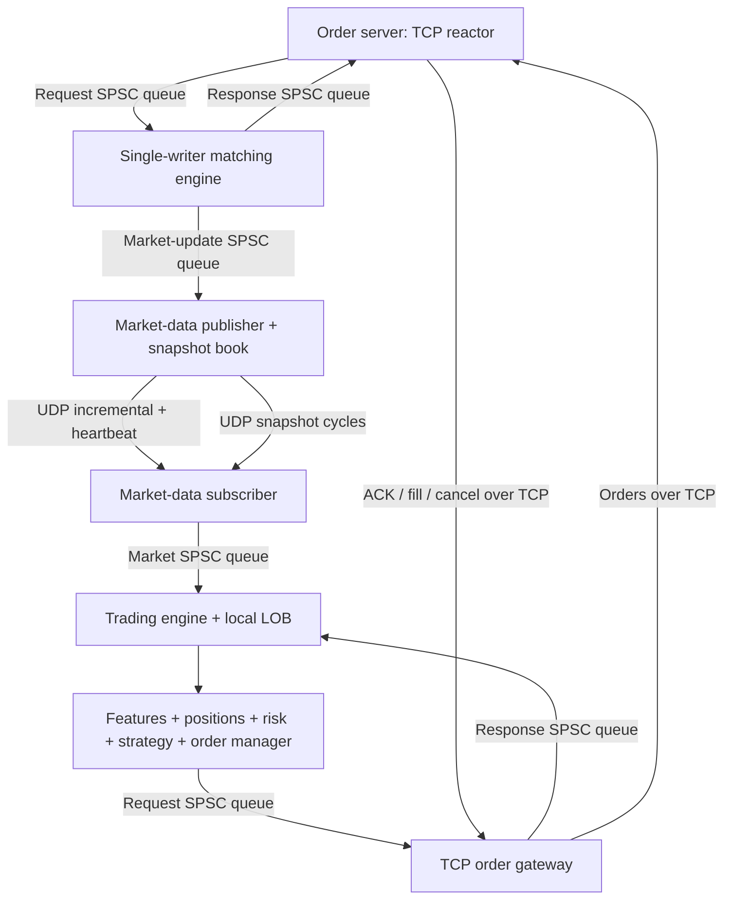

# Exchange and trading system

The exchange implements the complete application flow from the supplied diagram.
The design reference is Packt's [Building Low Latency Applications with C++, at
commit 11e3925](https://github.com/PacktPublishing/Building-Low-Latency-Applications-with-CPP/tree/11e3925f431f7c8c39739ed90b874d6ff2aa2966/Chapter10).
The implementation here uses this repository's C++20 book, pool, queues and logger.
It is independent source code with an explicit network codec, rather than packed
native structs from the reference.

| Reference component | Implementation here |
|---|---|
| Exchange matching books and client responses | `exchange::MatchingEngine`, `Request`, `Report`, pooled `OrderBook` |
| Order server and FIFO sequencer | Single TCP reactor feeding `RequestQueue`, per-recipient `ReportQueue` routing |
| Market publisher and snapshot synthesizer | Independent shadow `FeedBook`, incremental/heartbeat publisher and snapshot cycles |
| Order gateway and market-data consumer | `TradingClient` gateway/subscriber workers, `FeedConsumer` atomic recovery |
| Order manager, position keeper, risk manager | `ManagedOrder`, `Position`, outstanding-exposure checks in `TradingEngine` |
| Feature engine, market maker, liquidity taker, random | Microprice/trade ratio and three selectable strategies |
| Logging and measurement | Per-producer asynchronous `Logger`, queue metrics and matching latency benchmark |



## Build and run

```bash
cmake --preset debug
cmake --build --preset debug --parallel 4
python3 tools/run_trading_demo.py --bin-dir build/debug
```

The demo chooses unused local ports, starts an exchange, seeds two-sided
liquidity, runs a market maker and liquidity taker, and submits aggressive flow.
It prints position/PnL and queue/output summaries and saves every process's output
under a new `results/trading-demo-*` directory. Clients cancel their remaining
orders before the exchange drains and stops. An unsuccessful child process fails
the demo. No shell job cleanup is required.

For separate terminals:

```bash
# Exchange: numeric IPv4, explicit multicast interface, two instruments.
./build/debug/exchange_server --instruments 1,2 --snapshot-ms 100 \
  --log-prefix results/exchange

# Client 1 supplies liquidity and remains connected to receive passive fills.
./build/debug/trading_client --client-id 1 --orders examples/liquidity.orders \
  --run-ms 30000 --log results/liquidity.log

# Client 2 quotes around the quantity-weighted microprice.
./build/debug/trading_client --client-id 2 --strategy maker --clip 5 --run-ms 20000

# Client 3 follows sufficiently large aggressive trades with priced IOC orders.
./build/debug/trading_client --client-id 3 --strategy taker --trade-ratio 0.15 \
  --clip 5 --run-ms 20000

# Client 4 triggers trades. IDs only need to be unique within this instrument/client.
./build/debug/trading_client --client-id 4 --orders examples/aggressor.orders
```

`--strategy random --seed 42` supplies deterministic random order/cancel decisions.
Actual scheduling, exchange responses and fills depend on other clients. Maker
and taker strategies need an existing market; random mode can seed an empty book.
`--run-ms 0` runs until SIGINT/SIGTERM. Use a different client ID for each process.
`--help` lists configuration flags. Both binaries default to TCP 9000,
incremental multicast 9001, snapshot multicast 9002, group `239.255.42.1`, and
interface/address `127.0.0.1`. The exchange accepts TCP port 0 and announces the
assigned port on stderr for orchestration.

Order scripts are whitespace-separated, allow blank lines and `#` comments:

```text
NEW     1 10 BID 100 20 GTC POST_ONLY STP
REPLACE 1 10 BID 99  15 GTC STP
CANCEL  1 10 BID
NEW     2 11 ASK MKT 5 IOC STP
NEW     2 12 BID 102 8 FOK
```

The fields are type, instrument ID, client order ID, side, price (or `MKT`),
quantity, time-in-force and optional flags. CANCEL uses only the first four
fields. Script commands are paced and await the preceding command's Done report.
Local risk rejections are counted and do not consume a network request sequence.

## Matching and order lifecycle

- Each configured instrument has a separate price-time book. Bids sort descending,
  asks ascending, and orders at one price match FIFO. Trades execute at the passive
  order's price. Each match produces two private execution reports and a public
  trade followed by a passive Modify/Cancel. Only the aggressor's residual Add is
  published. Public IDs are exchange-generated and separate from client IDs.
- NEW acknowledges acceptance before its fills. Client order IDs are scoped by
  `(client, instrument)` and must be unique among live orders. CANCEL requires
  ownership and removes the remaining quantity.
- REPLACE quantity means **desired remaining quantity**, independently of earlier
  fills. A same-price reduction/equal quantity preserves FIFO and market order ID.
  Increasing quantity or changing price receives a new market ID and loses
  priority; it can immediately match. Rejected replacement leaves the old order
  unchanged. Side changes and market/IOC/FOK replacements are rejected.
- GTC rests its residual. IOC cancels the residual. An unpriced market order
  never rests, including when supplied with GTC. FOK preflights executable
  liquidity and rejects the entire order without any fills if insufficient.
- POST_ONLY rejects a crossing order and requires a priced GTC order. Optional STP
  cancels the aggressor's residual at the first own passive order; earlier fills
  against other clients remain valid. FOK preflight observes this same barrier.
- Instrument rules validate tick, lot, min/max price, maximum quantity and notional.
  Market-order notional uses the configured upper price band as its bound.

Allocation for reports, updates, identities and the incoming resting node is
reserved before matching. A capacity failure cannot partially fill an order or
remove a replaced order. Reserving a node also applies to orders that would fully
fill: a completely full pool can therefore reject even a fully executable
incoming order. The existing per-book byte budget is retained (16 KiB for list
nodes; actual order count depends on node size). Price maps, hash indexes,
identities and result vectors still allocate. This is not an allocation-free
matching implementation.

`MatchingEngine::process()` is single-writer and does not enforce transport
sequences itself. The order server owns that policy. Direct callers must supply
nonzero client, order, instrument and request IDs and serialize access.

## Market-data synchronization

Incremental Add/Modify/Cancel/Trade updates share one global sequence across
instruments, starting at 1 per exchange boot. Modify carries the new remaining
quantity and preserves queue position. A heartbeat every 100 ms advertises the
last published incremental without consuming another sequence; it detects a lost
tail even if no further trades occur.

The publisher independently consumes the engine's update queue and maintains a
snapshot book. A cycle consists of Begin, N Add rows in price/FIFO order, and End.
Begin/End carry the same boot session, cycle ID, incremental watermark and order
count. Rows have an independent consecutive snapshot sequence. An empty cycle is
valid and clears an obsolete local book atomically.

Subscribers can join late or recover after gaps. They buffer incrementals in a
bounded ordered map, build snapshots in a separate candidate, verify every row
and End, discard incrementals already covered by the watermark, and replay the
remaining consecutive suffix. They expose the candidate only after it reaches
all observed incrementals/heartbeats. An incomplete, inconsistent or out-of-order
snapshot is discarded; recovery waits for another complete cycle. Duplicate/old
incrementals are dropped. Buffers and accepted snapshot counts default to 65,536
messages/orders. Overflow invalidates the candidate and waits for a fresh cycle.

While the feed is recovering, malformed, timed out, or from a different boot than
the TCP reports, trading suppresses new orders and replacements. Cancels remain
available. A new boot clears the old feed; packets from smaller boot epochs are
ignored. Epochs are derived from system-clock nanoseconds and assume the clock
does not roll back between boots. Market-data recovery restores public resting
orders, rather than private execution history or exchange persistence.

## Trading state and risk

The strategy thread owns local books, managed orders, features and positions. TCP
and UDP workers only decode/queue data. Order states are pending new, live,
pending replace, pending cancel and dead. Pending requests reserve exposure;
a pending cancel does not release it until acknowledged. Replacements
conservatively reserve the larger of old remaining and requested quantity.
Terminal orders are removed from the active manager. Per-recipient report
sequences prevent duplicate fills from changing positions twice.

Positions track signed quantity, volume, average entry, realized PnL and
unrealized PnL. Reductions and reversals realize only the closed quantity;
remaining inventory marks at the latest available two-sided midpoint. Monetary arithmetic
uses `long double`; this is a simulation without fees or fixed-decimal accounting.
Features include quantity-weighted microprice and trade quantity divided by the
opposite best-level quantity. Features reset when quotes disappear or a snapshot
replaces the book; each taker trade signal is consumed once.

Pre-trade checks include maximum order size/notional, maximum absolute position
under worst-case same-side fills including outstanding orders, and maximum loss.
Limits are per instrument and configured by `--max-order`, `--max-notional`,
`--max-position` and a nonnegative `--max-loss` budget. A finite client notional
limit rejects unpriced markets; use a priced IOC to provide a hard price bound.
Cancels are allowed while risk is breached.

## Transport, queues, logs and shutdown

One nonblocking TCP reactor sequences complete commands in the order it reads
them, routes asynchronous passive fills, and serves up to 256 simultaneous peers.
This is userspace receive order, without hardware timestamps. A full request
queue stops new reads while the reactor continues sending responses. Every SPSC
queue holds 4096 messages. No producer overwrites a full queue. The trading
producer also drains responses while a large outbound batch applies backpressure.

Each peer has bounded framing/output storage and absolute partial-frame/output
burst deadlines. A slow or malformed peer is disconnected without stopping other
clients. TCP half-close drains accepted requests before closing the response
stream. Full disconnect does not cancel exchange orders automatically. Client IDs
are reserved for the lifetime of an exchange boot; a second connection cannot
claim an existing ID, even after disconnect. There is no order-session reconnect
or execution-report replay in this version. Unroutable reports are counted.

Clients cancel live orders and await completion on normal stop; an unreachable
exchange fails the bounded drain with an explicit unknown-outcome message. The
exchange stops ingress, finishes already enqueued commands, drains reports and
market updates, publishes a final snapshot, and joins workers. Timed-out peer
outputs may be abandoned after the configured shutdown deadline. SIGINT/SIGTERM
handlers only set a signal-safe flag; cleanup runs in normal application code.

`--log-prefix PREFIX` enables separate asynchronous matcher and publisher logs.
`--log FILE` enables the trading thread's asynchronous command/report/recovery
log. Each logger has exactly one producer. Accepted records drain after worker
shutdown; write/format failure fails the application, and full-queue drops are
reported as `log_dropped`. These are best-effort diagnostics, not a durable order
journal. Defaults leave logging disabled for throughput experiments.

The original CSV replay, 40-byte TCP event ingress and UDP event tools continue to
use their own protocol and sequencing semantics. The trading protocol below is
separate, including its policy of consuming rejected command sequences.

## Wire format

All integers are unsigned big-endian. No C++ structs are sent directly. Each frame
starts with four bytes `LBT2`, version 1, message kind, subtype and side (1=bid,
2=ask). Unknown enum values, reserved bits and nonzero padding are rejected.

| Request offset | Bytes | Field |
|---|---:|---|
| 0 | 8 | magic, version, kind=1, request type, side |
| 8 | 1 | flags: market=1, post-only=2, STP=4 |
| 9 | 1 | time-in-force: GTC=0, IOC=1, FOK=2 |
| 10 | 6 | zero |
| 16 | 8 each | client, request sequence, instrument, client order ID |
| 48 | 4 each | price, quantity |
| 56 | 8 | zero; total 64 bytes |

Request types are New=1, Cancel=2, Replace=3. Request sequences start at 1 and are
consecutive per connection, including matching rejections. Invalid framing,
identity changes and invalid sequences close the connection before enqueueing.
Cancel requires zero price/quantity/flags and GTC.

| Report offset | Bytes | Field |
|---|---:|---|
| 0 | 8 | header, kind=2, report type, side |
| 8 | 1 | status |
| 9 | 7 | zero |
| 16 | 8 each | response sequence, request sequence, client, instrument, client order, market order, trade ID |
| 72 | 4 each | execution/order price, execution/canceled quantity, leaves |
| 84 | 4 | zero |
| 88 | 8 | boot session; total 96 bytes |

Report types are Accepted=1, Rejected=2, Filled=3, Canceled=4, Replaced=5, Done=6.
A command produces one Done after its requesting-client reports. Passive fills
have request sequence 0 and no Done. Response sequences are consecutive per
recipient, including passive fills and Done. A successful Done confirms in-memory
processing. STP cancellation is conveyed in the Canceled report; its command still
has successful Done. Status values 0..11 are, in order: Ok, InvalidRequest,
UnknownInstrument, DuplicateOrder, UnknownOrder, InvalidPrice, InvalidQuantity,
Capacity, WouldCross, CannotFill, SelfTrade, RiskRejected.

| Market offset | Bytes | Field |
|---|---:|---|
| 0 | 8 | header, kind=3, update type, side |
| 8 | 8 each | session, sequence, snapshot cycle ID, watermark, instrument, market order, trade ID |
| 64 | 4 each | price, remaining/trade quantity |
| 72 | 8 | snapshot order count; total 80 bytes |

Types are Add=1, Modify=2, Cancel=3, Trade=4, SnapshotBegin=5, SnapshotEnd=6,
Heartbeat=7. Incrementals have zero cycle ID, watermark and count. Snapshot Add
rows carry a nonzero cycle ID and a watermark (watermark can be zero for an empty
history). Begin has sequence 0; End has sequence N+1. Begin/End use zero
instrument/order/trade/price/quantity. Heartbeat uses sequence=watermark and zero
cycle/body fields. One market frame is exactly one UDP datagram; truncated and
oversized datagrams are discarded and invalidate synchronization.

## Validation and measurement

```bash
./tools/run_tests.sh debug asan
python3 tests/exchange/test_system.py --bin-dir build/debug -v
cmake --preset release
cmake --build --preset release --parallel 4
./build/release/benchmark_matching 100000
```

Core tests compare 2,000 seeded mixed commands to an independent price-time model,
replay every emitted update into a shadow book, and check state after every
command. Cases cover FIFO, multi-level matching, both sides of fills, isolation,
allocation exhaustion, replacement priority/rollback, market/IOC/FOK/post-only/STP,
rules, risk reservations, PnL reversals, duplicate reports and strategies. Recovery
tests inject missing/reordered snapshot rows, buffered gaps, heartbeat tail loss,
boot changes and buffer overflow. Process tests independently encode frames,
exercise multiple real clients and multicast sockets, verify positions and
logging, and check a 5,000-command burst and graceful output drain.

`benchmark_matching` predecodes alternating Add/Cancel and Add/Match pairs. It
reports throughput, overall ns/event, and p50/p95/p99 process-call latency, checks
successful processing and final invariants, and emits an observable checksum.
The overall rate includes result destruction and timing overhead; per-call
percentiles exclude result destruction. Construction/predecoding and sorting
measurements are outside timing. These are local engine measurements with logging
and networking disabled, not end-to-end latency or stable performance guarantees.

The implementation remains an educational exchange: state is in memory, client
IDs are not authentication, and the demo has no durable order journal, restart
recovery, HA or private session replay. The reference's experimental optimized
containers and hardware-specific tuning are not performance claims for this
repository. The roadmap tracks those future extensions separately.
