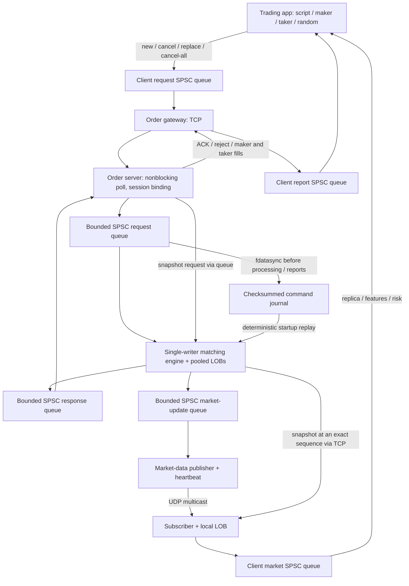

# Local trading system

The project now has two entry points: the original reconstructive market-data LOB,
and an exchange simulator that **accepts order commands, matches them, generates
trades, and routes private execution reports**. The simulator and every local
market-data replica use the existing pooled `OrderBook`.

The architecture follows the exchange, order gateway, market-data and strategy
components in [Packt's reference at the requested commit](https://github.com/PacktPublishing/Building-Low-Latency-Applications-with-CPP/tree/11e3925f431f7c8c39739ed90b874d6ff2aa2966/Chapter12).
The implementation is written for this project's APIs. It does not vendor the
reference source or claim the reference's performance numbers.

The unified implementation combines PR #16's durable exchange, server-side risk,
TCP snapshots and CI with PR #17's queued client transport, market features,
coordinated shutdown and transport stress coverage. One `LTR1` protocol and one
matching implementation are maintained. Snapshot recovery deliberately uses TCP
with a buffered multicast suffix; a second periodic multicast snapshot protocol
is not introduced.



The server has one I/O thread for all TCP clients, one engine thread, one publisher
thread, and the existing logger worker. Only the engine mutates exchange books.
Each SPSC queue has capacity 4096 and exactly one producer/consumer. A Linux
`eventfd` wakes the TCP poller when reports become available. The client keeps
strategy, order management, features, positions and replica state on one application
thread; separate gateway and multicast workers exchange messages through three
bounded SPSC queues. Workers retain messages while snapshot transfer blocks the
strategy thread. The buffered suffix must validate before new risk is allowed.
The command API stays serialized: one caller waits for each Complete, so there
is only one command in flight per application client.

## Build and run the verified scenario

```sh
cmake --preset release
cmake --build --preset release --parallel 4
python3 tools/run_trading_demo.py --bin-dir build/release
```

The script starts an exchange on an ephemeral TCP port, starts a maker with a bid
and ask, waits for both acknowledgements, then starts a taker that buys four at
101 and sells three at 99. It verifies two trades, quantity seven, conservation of
cash and positions, synchronized snapshots and journal replay. A final observer
verifies the empty book after both clients cancel their remaining orders. Clients
can exit at different valid watermarks because exit itself generates cancels. All
processes stop after the scenario. No exchange account or elevated privileges
are required.

Each run creates `results/trading-<UTC timestamp>/` with command journal, logs,
private reports, client summaries, exchange metrics, recovered summary and
`summary.json`. An existing output directory is never overwritten. Example:

```sh
python3 tools/run_trading_demo.py --bin-dir build/debug
```

## Interactive processes

Start the exchange first:

```sh
./build/release/exchange_server --rules configs/instruments.csv \
  --tcp-port 9100 --md-port 9101 --journal exchange.journal
```

Then start strategies in separate terminals:

```sh
./build/release/trading_app --client-id 10 --strategy maker \
  --fair-price 100 --edge 2 --clip 5 --duration-ms 10000
./build/release/trading_app --client-id 11 --strategy taker \
  --fair-price 105 --edge 1 --clip 2 --duration-ms 4000
```

Trading apps cancel remaining orders on normal exit and SIGINT/SIGTERM, await
completion and join both I/O workers. `--cancel-on-exit 0` explicitly leaves script
orders at the exchange; later use of the same private account still requires
reconciliation. Failed cancellation reports an error. Ctrl-C/SIGTERM to
the **server** stops ingress, drains requests already admitted to the queue,
drains output queues and accepted logs, then joins workers. TCP input still in a
client/kernel buffer has not been admitted. Shutdown has a five-second drain
bound; failure to drain produces a nonzero exit, never a false successful stop.

`--journal -` disables persistence for disposable experiments. With a journal,
restart with the same instrument configuration to restore books, client request
sequences, exchange order/trade IDs and positions before accepting clients.
Give each experiment a new journal or deliberately reuse its state. The sample
app requires a fresh client ID: a reused account may have unobserved private
fills, so it refuses to reset its local risk state silently. A raw gateway can
query `Status` and reconcile explicitly; automatic private-session reconciliation
is a future feature. Restarted exchange epochs stop existing trading apps.

The default order listener is deliberately bound to `127.0.0.1`. Client IDs are
local simulator identities, with one live connection per ID; they are not an
account authentication system. These tools do not connect to a real venue.

## Order commands and matching contract

- Multiple configured instruments; client order IDs are unique and increasing
  **per client across instruments**. Exchange order IDs are globally generated.
- Global FIFO arrival order is the order in which the I/O thread enqueues complete
  frames. There is no claim to kernel/NIC hardware timestamp arbitration.
- Limit GTC rests the unfilled remainder. Matching chooses the best opposite
  price, then oldest resting order, and executes at the **maker price**.
- Market orders require IOC or FOK, price zero and no post-only flag. They never
  rest. IOC expires any unfilled remainder; FOK preflights all eligible liquidity
  and performs no trades when insufficient.
- Post-only is limit GTC and rejects when crossing liquidity exists.
- Self-trade prevention rejects the **whole incoming command** before any fills
  if its planned sweep would reach that client's own resting order.
- Cancel addresses an owned client order on the specified instrument. Cancel-all
  with instrument zero cancels all that client's orders; a nonzero instrument
  limits its scope. Disconnect alone leaves resting orders live.
- Replace quantity means **desired remaining quantity**. Same-price reductions
  preserve FIFO priority and exchange ID. Price changes or increases reserve a
  new node and lose priority. Side/instrument changes are rejected. The old order
  remains intact when replacement validation or resource reservation fails.
- A full pool can reject an order requiring a resting residual even if it would
  free nodes during its planned sweep. Reservation happens before any fills, so
  capacity rejection never partially executes a command.
- Both maker and taker receive a `Fill` carrying the same trade ID. Private fills
  are delivered even when the maker has no command outstanding. Public deltas
  contain exchange order IDs and remove private client/order IDs.

Each business command produces zero or more reports and a terminal `Complete`.
A well-sequenced business rejection consumes the request ID. Bad sequence rejects
without advancing it. An identical retry of the **most recent** command returns
its cached private reports without repeating matching or market updates. Reusing
that request ID with different fields fails. Older request replay beyond that
single cached result is unsupported. Clients deduplicate response sequences before
changing local positions.

## Validation and risk

`configs/instruments.csv` sets instrument, tick, lot, min/max price, maximum order
quantity, per-order notional, absolute position and open-order limits. The built-in
defaults support instruments 1 and 2 with one-unit tick/lot. The example rules file
makes instrument 2 use five-unit ticks and ten-unit lots.

The exchange validates configuration and every incoming order. Position checks
include the client's outstanding quantity on the same side; replace excludes the
old reservation. Open-order limits include the client's orders across instruments.
For market orders, notional uses the configured upper price band as a conservative
worst-case price. Reducing an order still goes through validation.

The trading app also reserves exposure in its order manager and checks quantity,
notional, position and mark-to-market loss before sending. Unsynchronized market
data blocks new/replacement orders. Cancellation remains available under the
local kill switch. Positions track quantity, cash, volume, average cost, realized
PnL and PnL at a supplied mark; accounting uses integer price ticks and `long double`
for averages/PnL. Fees, funding, margin and settlement are outside this simulator.

The maker quotes around a configured fair price with inventory skew, manages one
bid/ask per instrument and cancels a side when its inventory limit is reached.
The taker sends IOC orders only when the observed opposite price offers the
configured edge. Random trading uses a seeded generator and IOC orders. These
are demonstrator strategies, not claims of profitable signals.

`--pricing microprice` replaces the maker/taker fair-price anchor with the
quantity-weighted microprice when both BBO sides exist; configured fair price is
used to seed an empty market. `--signal trade-ratio --trade-ratio 0.2` makes the
taker follow aggressive trades above the specified depth ratio, once per trade ID.
The denominator is captured before the passive Execute update, even though Trade
arrives afterwards. Snapshot recovery resets signals and reconstructs microprice.
`--pricing fixed --signal edge` retains the configured-price strategy behavior.

```sh
./build/release/trading_app --client-id 20 --strategy maker --pricing microprice
./build/release/trading_app --client-id 21 --strategy taker --signal trade-ratio --trade-ratio 0.2
```

## Scripts

```text
action,instrument,order_id,side,type,tif,price,quantity,post_only
NEW,1,1,SELL,LIMIT,GTC,101,10,1
REPLACE,1,1,SELL,LIMIT,GTC,102,8,1
WAIT,1000
CANCEL,1,1,SELL,LIMIT,GTC,0,0,0
SNAPSHOT
```

`WAIT,<milliseconds>` polls fills and market data while waiting; `SNAPSHOT` forces
recovery. Other commands require all nine fields, including placeholders for
unused cancel fields. Comments start with `#`; CRLF is accepted. See
[the maker](../examples/trading/maker.csv) and [taker](../examples/trading/taker.csv).
Use `trading_app --help` and `exchange_server --help` for options. The app emits
JSON reports and a final summary for `--instrument` (default 1); the order manager
maintains positions for every instrument present in its reports.

## Market-data recovery

A subscriber joins multicast **before** requesting a snapshot over a separate TCP
connection. The engine captures all orders in price-time order between two
commands, with one exchange epoch, sequence watermark and count. The consumer
builds a private temporary book and swaps only after count, IDs, watermarks and
invariants validate. Queued incrementals at or below the watermark are discarded.
A delta must advance the global feed sequence by exactly one.

Gaps, bad lengths, truncation, invalid frames and epoch changes invalidate the
replica. A 100 ms publisher heartbeat carries the latest emitted watermark, so a
lost tail is detected without a subsequent trade. The client also refreshes after
500 ms with no feed messages. It requests another snapshot on a feed fault.
Recovering the market book does not reconcile missed private executions; a gateway
failure or exchange restart stops the sample app with a reconciliation error.

UDP is best effort and has no delivery ACK. Snapshot transfer is TCP, not multicast;
this differs from the reference's periodic multicast snapshot channel. There is
no reorder window or retransmission cache. Under sustained loss a client can
remain unable to trade; it must never treat an incomplete book as synchronized.
Verified network scenarios use multicast loopback, not a physical LAN.

## Wire format

The new protocol is separate from the unchanged original `LOB1` event/ACK codec.
Every TCP message or UDP datagram is exactly **96 bytes**, explicitly big-endian;
no packed structs, host enum layout or pointers appear on the wire.

| Offset | Bytes | Field |
|---|---:|---|
| 0 | 4 | `LTR1` magic |
| 4 | 1 | Version 1 |
| 5 | 1 | Kind: command=1, report=2, delta=3, heartbeat=4, snapshot begin/order/end=5/6/7 |
| 6 | 1 | Action: new/cancel/replace/cancel-all/snapshot/status=1..6 |
| 7 | 1 | Side: bid=0, ask=1 |
| 8 | 1 | Order type: limit=1, market=2 |
| 9 | 1 | TIF: GTC=1, IOC=2, FOK=3 |
| 10 | 1 | Report: accepted/rejected/fill/cancelled/replaced/complete/status=1..7 |
| 11 | 1 | Reject reason: see `Reject` in messages.hpp |
| 12 | 1 | Post-only: 0/1 |
| 13 | 1 | Delta: add/cancel/execute/reduce/trade=1..5 |
| 14 | 2 | Reserved zero |
| 16 | 8 | Exchange epoch |
| 24 | 8 | Sequence (global market stream or global report stream) |
| 32 | 4 | Client ID |
| 36 | 4 | Price ticks |
| 40 | 8 | Client request ID |
| 48 | 8 | Client order ID |
| 56 | 8 | Exchange order ID |
| 64 | 8 | Instrument ID |
| 72 | 4 | Quantity (new remaining quantity for Reduce) |
| 76 | 4 | Remaining quantity |
| 80 | 8 | Trade ID |
| 88 | 8 | Reserved zero |

Unused enum slots still contain valid defaults. Invalid version, enums, booleans
or reserved bytes fail decoding. TCP parsing handles fragmented/coalesced frames
with partial reads/writes. Unknown client mutations close the connection; a second
live session for the same ID receives `session_busy`. Maximum 64 simultaneous
connections and 4096 buffered output frames per client prevent unbounded buffering; a stalled
or partial client times out after five seconds and cannot block other clients.

## Persistence and failure boundaries

The journal holds a version/configuration fingerprint followed by checksummed
96-byte command records. It has an exclusive process lock. The server writes and
`fdatasync`s a full record **before** applying a command or enqueueing reports.
New-file creation also syncs its parent directory. Recovery replays commands in
order before opening the listener, including rejections and the last-request
cache. FNV checksums detect accidental damage; they are not authentication.

A short/corrupt record or changed configuration fails startup. The journal is
never silently truncated or skipped. Keep verified backups for manual repair.
There is no rotation, engine checkpoint compaction, active/passive replication or
exactly-once guarantee across an uncertain TCP disconnect. Replay semantics and
journal schema must be versioned together. Audit logging remains best-effort and
is independent of the durable command journal.

```sh
./build/release/exchange_replay exchange.journal configs/instruments.csv
```

Metrics can be written with `exchange_server --metrics results/metrics.json` on
shutdown: commands, rejections, trades, quantity, market sequence, datagrams,
connections, slow clients and malformed inputs. The existing asynchronous logger
records command context; private reports and journal records carry business results.

## Validation and measurement

See [the verification record](trading_validation.md) for the completed runs and
the host limitation affecting TSan.

```sh
./tools/run_tests.sh debug asan
ctest --test-dir build/debug -R 'Matching|MarketRecovery|TradingSystem' --output-on-failure
python3 tests/trading/test_system.py --bin-dir build/debug -v
./build/release/trading_benchmark --iterations 10000 --output results/trading-benchmark.json \
  --samples results/trading-latencies.csv
```

Unit tests cover FIFO and multi-level sweeps, IOC/FOK, post-only, STP, cancel/replace,
capacity rejection with planned fills, instrument/risk rules, idempotence, position
accounting, strict codecs, snapshot faults and journal replay/corruption. A seeded
2,000-order workload compares every execution to an independent price-time model.
Process tests exercise actual multi-client TCP, private maker fills, multicast
fan-out and heartbeats, partial input, restart recovery and the C++ trading apps.
Additional cases exercise microprice quotes, pre-Execute trade signals, SIGTERM
cancellation, TCP half-close and a 5,000-command FIFO/drain burst.
The original core, memory, logging, TCP, UDP and allocation tests remain enabled.

The standalone benchmark predecodes a deterministic mix of add, quantity reduction,
match and cancel commands, warms a separate engine and measures each `process()`.
It reports mean, p50/p95/p99 and maximum wall-clock nanoseconds, including engine
allocations/output generation and timer overhead. It validates every result and
final invariants before publishing numbers. It excludes network, queues, journal,
configuration and CSV parsing. It is not end-to-end exchange latency. Pin CPUs,
record compiler/hardware settings and retain raw results before comparing runs.

This is a complete local trading **pipeline**, with standard containers and some
allocations still on its hot path. It has no real-venue adapter, account security,
clearing/settlement, live production operations or measured HFT latency guarantee.

## Remaining work

- Replay observability: per-event results and top-of-book output with `--verbose`,
  plus an explicit `--continue-on-error` mode.
- Engine checkpoints and journal rotation/compaction.
- End-to-end throughput and latency measurements including queues, networking and
  journaling; `perf stat`, flame graphs and a regression baseline.
- UDP reorder buffering/retransmission and a multicast snapshot channel.
- Private gateway reconnect and reconciliation for unobserved fills.
- Live monitoring, active/passive failover and operational tooling.
